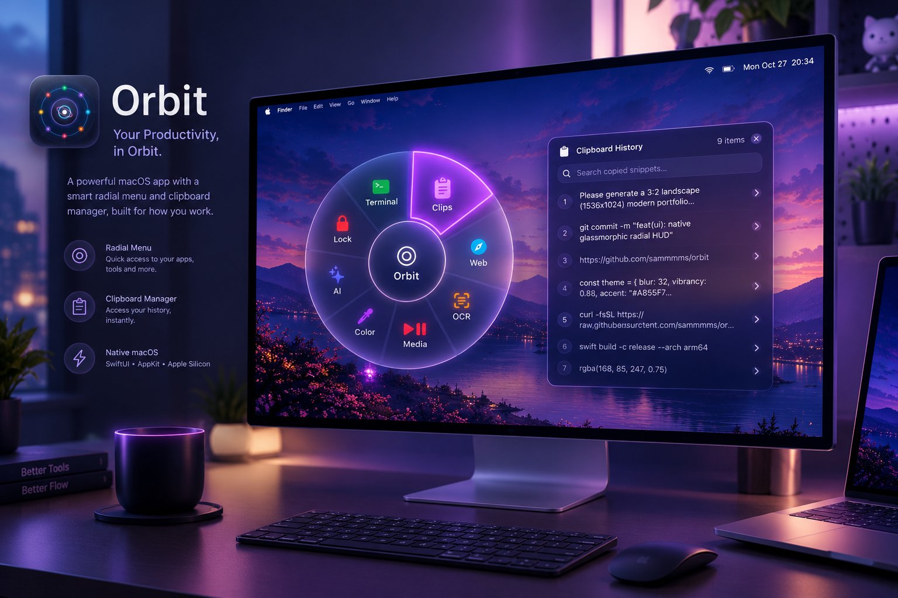
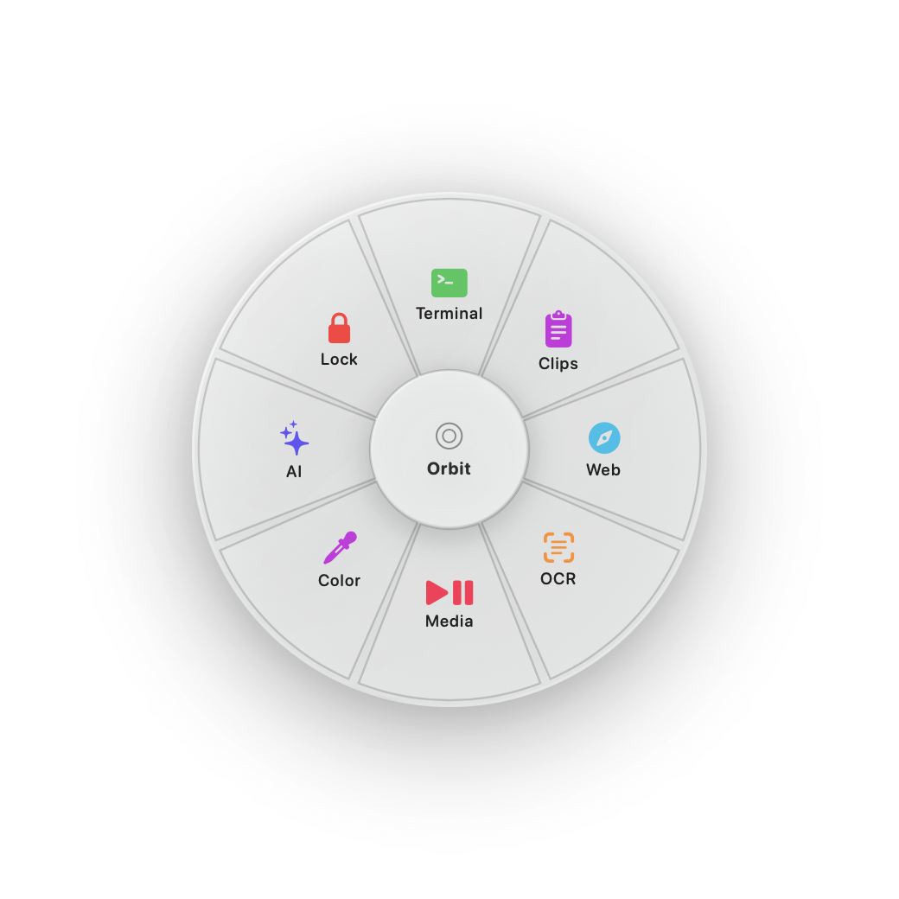
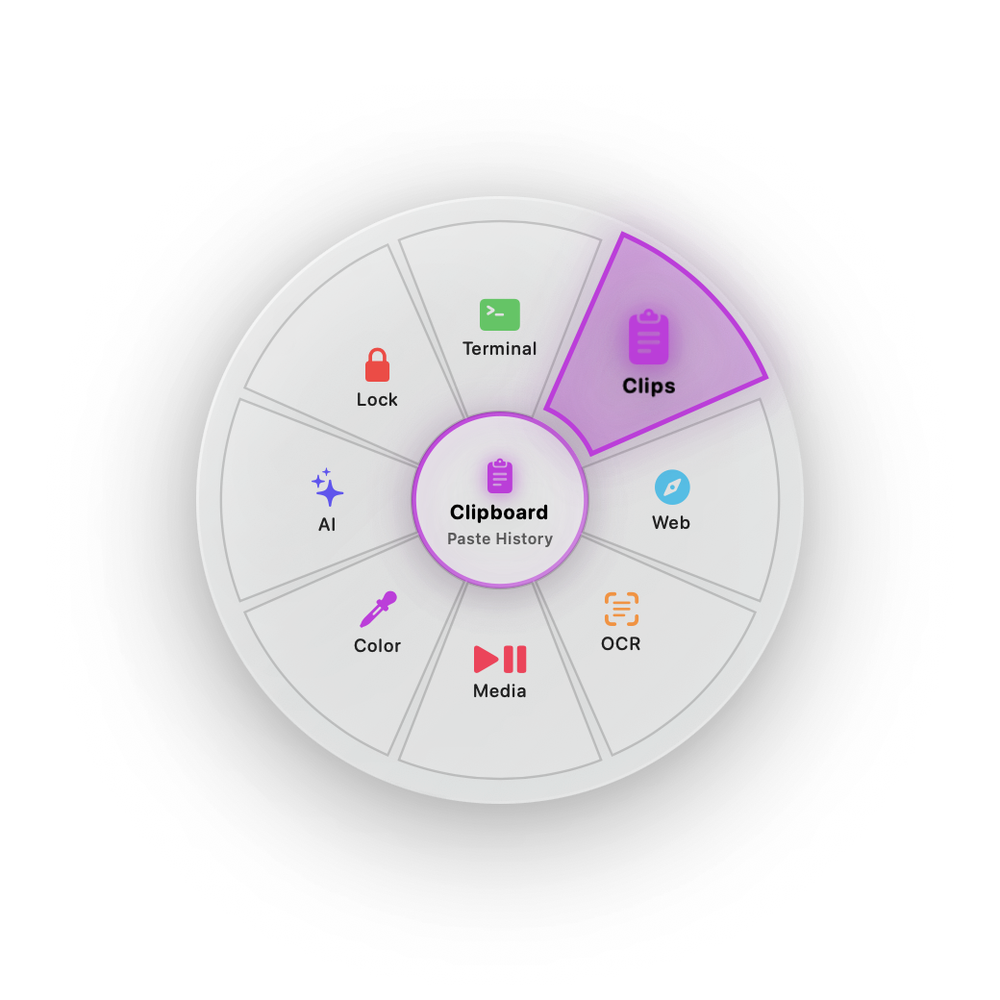
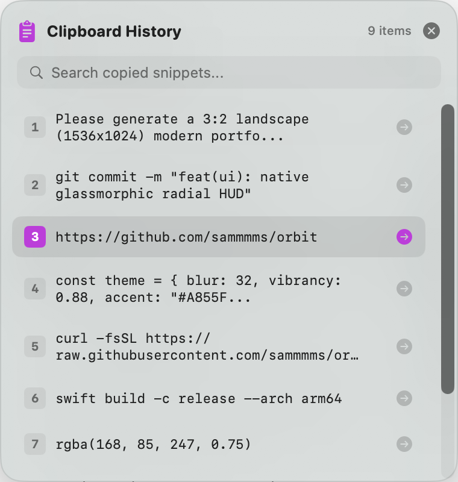

<p align="center">
  
</p>

<p align="center">
  <a href="https://github.com/sammmms/orbit/stargazers"></a>
  
  
  
  
  
</p>

---

# 🪐 Orbit

> **Your Productivity, in Orbit.**
> A blazing-fast native radial menu (pie menu) and glassmorphic clipboard manager for macOS written in **100% pure Swift & SwiftUI**.

Hold a hotkey or middle-click anywhere on macOS, and a frosted-glass radial wheel pops up directly under your cursor. Flick your mouse towards any slice and release to launch apps, run terminal workflows, snip & OCR text from your screen, control media, or search & paste clipboard history with zero friction.

---

## 📸 Visual Showcase

<p align="center">
  
  
  
</p>

---

## ✨ Why Orbit?

* **Fitts’s Law Speed:** Every option is equidistant from your mouse cursor. Selecting an item requires an angular flick rather than precision aiming, developing subconscious muscle memory over time.
* **100% Native & Featherweight:** 
  * Binary size: **~480 KB** (no Electron, no webview, zero external dependencies).
  * Memory: **< 25 MB** RAM.
  * Launch latency: **< 5 ms**.
* **Liquid Glass UI:** Built with native macOS GPU-accelerated blur (`NSVisualEffectView`), multi-tier drop shadows, bouncy spring animations, and subtle haptic feedback.
* **Supercharged Actions:**
  * 📋 **Glassmorphic Clipboard Hub:** Floating history panel with live fuzzy search, `1-9` quick keyboard shortcuts, and bulletproof native auto-paste engine (CoreGraphics event injection).
  * 💻 **Instant App Launcher:** Fast-switch to your favorite terminals (Ghostty, Alacritty, iTerm), editors, or tools.
  * 📷 **Screen OCR:** Interactive screen selection -> native Apple Vision text recognition -> plain text copied to clipboard.
  * 🎵 **Media Controller:** Fast play/pause toggle for Spotify and Apple Music.
  * 🎨 **Native Color Sampler:** Screen eye-dropper that copies hex (`#RRGGBB`) directly to clipboard.
  * 🔒 **Screen Lock:** Immediate sleep/lock display for privacy with a quick flick.
  * ⚡ **Shell Scripting & URLs:** Run arbitrary background zsh commands or jump to web destinations.
* **Fully Configurable via JSON:** Customize items, icons, colors, and radii in `~/.config/orbit/config.json`.

---

## 🚀 Triggers & Controls

Orbit supports multiple intuitive trigger styles out of the box:

| Trigger | How it Works |
|---|---|
| **⌥ Option + Space** | Global Carbon HotKey — bypasses terminal suppression. Pops up wheel at cursor. Move & click or hit **Esc** to dismiss. |
| **Middle Click (Hold & Flick)** | Hold scroll wheel down anywhere -> flick cursor toward slice -> release to execute! |
| **Option Hold** | Hold the `⌥ Option` key for >180ms -> wheel appears -> flick and release. |
| **Numeric Shortcuts** | Inside Clipboard Panel, press `1` through `9` to instantly paste that snippet into the active app. |

---

## 🛠️ Installation & Building

### Requirements
* macOS 14.0+ (Sonoma, Sequoia, or newer)
* Swift 6.0+ / Xcode Command Line Tools

### Quick Build & Run
```bash
# Clone the repository
git clone https://github.com/sammmms/orbit.git
cd orbit

# Build and run directly
swift run

# Or package into a standalone signed macOS .app bundle
./scripts/bundle.sh run
```

This packages `Orbit.app` with an official high-resolution icon. You can drag `Orbit.app` to `/Applications` or add it to **System Settings > General > Login Items**!

---

## ⚙️ Configuration

Orbit creates its configuration file automatically at:
```bash
~/.config/orbit/config.json
```
You can also click the Orbit status icon in your **Menu Bar** and select **"Edit Configuration..."** to open it instantly.

### Sample Configuration
```json
{
  "appearance" : {
    "hapticsEnabled" : true,
    "innerRadius" : 46,
    "radius" : 145,
    "soundEnabled" : true
  },
  "items" : [
    {
      "action" : "openApp",
      "color" : "green",
      "icon" : "terminal.fill",
      "id" : "terminal",
      "payload" : "Ghostty",
      "subtitle" : "Launch Ghostty",
      "title" : "Terminal"
    },
    {
      "action" : "clipboardHistory",
      "color" : "purple",
      "icon" : "list.clipboard.fill",
      "id" : "clipboard",
      "payload" : "",
      "subtitle" : "Paste History",
      "title" : "Clips"
    },
    {
      "action" : "openUrl",
      "color" : "cyan",
      "icon" : "safari.fill",
      "id" : "browser",
      "payload" : "https://google.com",
      "subtitle" : "Open Web",
      "title" : "Browser"
    },
    {
      "action" : "ocr",
      "color" : "orange",
      "icon" : "text.viewfinder",
      "id" : "ocr",
      "payload" : "",
      "subtitle" : "Copy Text",
      "title" : "Screen OCR"
    },
    {
      "action" : "mediaPlayPause",
      "color" : "pink",
      "icon" : "playpause.fill",
      "id" : "media",
      "payload" : "",
      "subtitle" : "Toggle Audio",
      "title" : "Play / Pause"
    },
    {
      "action" : "colorPicker",
      "color" : "purple",
      "icon" : "eyedropper.halffull",
      "id" : "color",
      "payload" : "",
      "subtitle" : "Pick Hex",
      "title" : "Color Picker"
    },
    {
      "action" : "openUrl",
      "color" : "indigo",
      "icon" : "sparkles",
      "id" : "ai",
      "payload" : "https://chatgpt.com",
      "subtitle" : "Chat & Search",
      "title" : "Ask AI"
    },
    {
      "action" : "lockScreen",
      "color" : "red",
      "icon" : "lock.fill",
      "id" : "lock",
      "payload" : "",
      "subtitle" : "Sleep Mac",
      "title" : "Lock Mac"
    }
  ],
  "trigger" : {
    "enableMiddleClick" : true,
    "holdDurationMs" : 180,
    "holdModifier" : "Option",
    "hotkey" : "Option+Space"
  }
}
```

### Supported Actions:
* `"clipboardHistory"`: Opens the modern floating Clipboard History HUD with live filtering and auto-paste.
* `"openApp"`: Launches application by name or bundle id (`"payload": "Ghostty"` or `"Visual Studio Code"`).
* `"openUrl"`: Opens web address in default browser (`"payload": "https://github.com"`).
* `"runScript"`: Executes arbitrary shell commands via zsh (`"payload": "git status"` or custom bash alias).
* `"ocr"`: Interactive screen snip with automatic optical character recognition to clipboard.
* `"mediaPlayPause"`: Toggles play/pause for Spotify or Apple Music.
* `"colorPicker"`: Native macOS pixel color sampler.
* `"lockScreen"`: Puts Mac display to sleep immediately.

---

## 🔒 Permissions

Because Orbit simulates paste keystrokes into active applications and handles global hotkeys:
* macOS requires **Accessibility Permissions** (`System Settings > Privacy & Security > Accessibility`).
* Orbit prompts for trusted status on launch, and will automatically guide you if permissions are needed.

---

## 📂 Architecture

```
Orbit/
├── assets/
│   ├── banner.jpg                     # Official 3:2 portfolio showcase banner
│   └── banner_refs/                   # Retina transparent HUD assets & icon
├── scripts/
│   ├── bundle.sh                      # Builds, signs, and packages Orbit.app
│   ├── generate_icon.swift            # Generates master AppIcon.icns
│   └── generate_banner_assets.swift   # Automated screenshot & HUD asset generator
└── Sources/Orbit/
    ├── main.swift                     # App entry point
    ├── AppDelegate.swift              # Background agent lifecycle & notifications
    ├── Models/
    │   └── RadialItem.swift           # Codable configuration & state models
    ├── Services/
    │   ├── ActionExecutor.swift       # OCR, App launch, scripts, and media toggle
    │   ├── AppState.swift             # Tracks external active applications
    │   ├── CarbonHotKeyManager.swift  # Global Option+Space hotkey registration
    │   ├── ClipboardHistoryManager.swift # Clip polling, storage, & CoreGraphics auto-paste
    │   ├── ConfigManager.swift        # JSON persistence (~/.config/orbit/)
    │   └── EventTapManager.swift      # CGEventTap session listener (middle click & hold)
    └── UI/
        ├── ClipboardHistoryView.swift # Glassmorphic SwiftUI clipboard panel
        ├── ClipboardPanelController.swift # Floating borderless NSPanel manager
        ├── MenuBarController.swift    # NSStatusItem menu bar integration
        ├── RadialMenuView.swift       # SwiftUI interactive pie menu & animations
        ├── RadialMenuOverlayView.swift# Full-screen event-catching overlay
        ├── RadialPanel.swift          # Non-activating floating HUD window
        ├── RadialSliceShape.swift     # Annular sector trigonometry
        └── VisualEffectBlur.swift     # GPU hardware Gaussian blur wrapper
```

---

## 📄 License

MIT License © 2026 Samuel (@sammmms).
